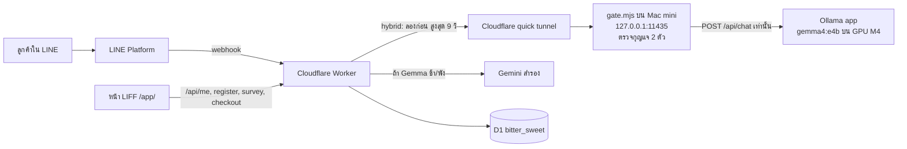
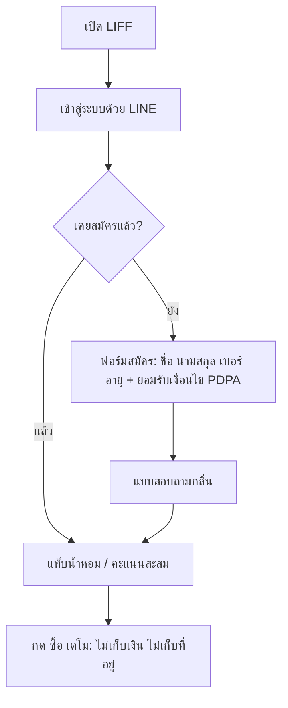

# รายงานการติดตั้ง Mac mini M4 + Deploy แบบ hybrid (31 ต.ค. 2026)

สรุป: บอท LINE ของ BitterSweet ตอบด้วย Gemma (gemma4:e4b) ที่รันบน Mac mini M4 ผ่าน Cloudflare quick tunnel
โดยมี Gemini เป็นตัวสำรอง (โหมด `hybrid`) และหน้า LIFF มีระบบสมัครสมาชิก แบบสอบถาม และปุ่มซื้อแบบเดโม
ภาพรวมทั้งระบบอยู่ที่ `docs/OVERVIEW.md`

- Branch: `v006-mini` (commit ล่าสุดที่ deploy: `786d4d2`)
- Worker version ที่ใช้งานอยู่: `ed849c9d-dc31-4554-a467-8f4b87cabe4a`
- Version ก่อนเริ่มงานนี้ (ไว้ rollback): `25809bdd-bc56-42e0-aa8a-eaafa47eb2fc`

## 1. ภาพรวมระบบ (flow)

### ลำดับการใช้งานหน้า LIFF

## 2. สิ่งที่ทำบน Mac mini

| ขั้น | รายละเอียด |
|---|---|
| ตรวจเครื่อง | Apple M4, RAM 16 GB, macOS 26.3.1, ดิสก์ว่าง 215 GB |
| Ollama | แอป Ollama 0.40.13 (จาก ollama.com), ดึง `gemma4:e4b` (9.5 GB), ตั้ง `OLLAMA_KEEP_ALIVE=-1`, `OLLAMA_NUM_PARALLEL=2` → โมเดลค้างใน GPU ตลอด |
| เครื่องมือ | แก้สิทธิ์ `/opt/homebrew` (Unity รัน sudo เอง), ติดตั้ง `cloudflared`, `gh` |
| โค้ด | clone repo (public) branch `v006-mini` ไปที่ `~/bittersweet-model-local` |
| Tunnel | `nohup sh mac-mini/start.sh` สร้าง `mac-mini/.env` (กุญแจสุ่ม) + เปิด gate + quick tunnel; log ที่ `~/bittersweet-tunnel.log` |
| Secrets | `sh mac-mini/set-worker-secrets.sh` → `LLM_ACCESS_CLIENT_ID/SECRET` ใน Worker (ไม่แสดงค่า) |
| Deploy | `npx wrangler deploy --var LLM_PROVIDER:hybrid --var LLM_BASE_URL:<tunnel>` (ไม่ใส่ URL ใน `wrangler.toml` เพราะ repo เป็น public) |
| D1 | `migrations/0002_surveys_members.sql` เพิ่มตาราง `members`, `surveys`, `orders` (CREATE IF NOT EXISTS ไม่แตะตารางเดิม) |

## 3. ประวัติการ deploy

| เวลา (UTC) | Version | Commit | เนื้อหา |
|---|---|---|---|
| 15:55 | `4ef67873` | `bc8b048` | hybrid ครั้งแรก |
| 16:03 | `d89146ee` | `3a5c040` | แก้คอลัมน์ `points` → `amount` (LIFF พัง) |
| 16:05 | `43604a32` | `64f7f21` | เอา repeat_penalty ออก, num_predict 800 |
| 16:18 | `870a6da3` | `34256f6` | สมัครสมาชิก + แบบสอบถาม |
| 16:19 | `ed849c9d` | `786d4d2` | + ปุ่มซื้อแบบเดโม (ใช้งานอยู่) |

## 4. ผลทดสอบ

### ความปลอดภัยของ gate (ผ่าน tunnel)

- `GET /api/tags` → 404 ✅ (ดู/ลบ/ดึงโมเดลจากข้างนอกไม่ได้)
- `POST /api/chat` ไม่มีกุญแจ → 401 ✅

### เวลาตอบของ Gemma ผ่าน tunnel (วินาที, เพดาน hybrid 9 วิ)

| ข้อความ | 3a5c040 รอบ1 | 3a5c040 รอบ2 | 64f7f21 รอบ1 | 64f7f21 รอบ2 |
|---|---|---|---|---|
| สวัสดีครับ แนะนำน้ำหอมให้หน่อย | 13.1 ❌ | 10.8 ❌ | 4.1 | 3.7 |
| ชอบกลิ่นชาเขียว ใส่ไปทำงาน | 10.7 ❌ | 4.0 | 3.7 | 3.7 |
| Sample ราคาเท่าไหร่ครับ | 10.5 ❌ | 3.6 | 13.3 ❌ | 13.2 ❌ |
| อยากซื้อขวดใหญ่ 1 ขวด | 9.7 ❌ | 9.5 ❌ | 3.7 | 3.9 |
| ผิวแพ้ง่าย ใช้ได้ไหมคะ | 3.8 | 3.9 | 3.6 | 4.0 |

❌ = `local_bad_done_reason length` (Gemma พิมพ์ยาวจนชน limit) → Worker ส่งต่อให้ Gemini

### ทดสอบจริงใน LINE / LIFF (version ed849c9d)

- `/api/me` Ok, `/api/register` Ok (members = 1), `/api/survey` Ok (surveys = 1)
- `/api/checkout` Ok 2 ครั้ง, `orders` = 0 (ถูกต้องตามโหมดเดโม)

## 5. ปัญหาที่เจอและการแก้

| ปัญหา | สาเหตุ | สถานะ |
|---|---|---|
| LIFF "โหลดข้อมูลไม่สำเร็จ" | D1 จริงใช้คอลัมน์ `points.amount` แต่โค้ดเรียก `points.points` | แก้แล้วใน `3a5c040` (ไม่แก้ DB) |
| บอทตอบ "ขัดข้อง" | Gemma ใช้ 25 วิ → timeout → Gemini ตอบ 503 + timeout | ลดลงหลัง `64f7f21`; ข้อ "Sample ราคา" ยังพังบ่อย |
| test บน Mac ล้ม 51/170 | `test/fakeD1.ts` (node:sqlite) ขึ้น "column index out of range" เฉพาะเครื่องนี้ | commit เดียวกันผ่านบน cloud; ไม่กระทบ production |
| `crm_not_configured` | ยังไม่ได้ตั้งค่า Google Sheet | รอตั้งค่า |
| brew ติดตั้งไม่ได้ | `/opt/homebrew` เป็นของ user อื่น | Unity รัน `sudo chown` แล้ว |

## 6. การดูแลระหว่างเดโม

- อย่าให้ Mac mini sleep และอย่าปิดแอป Ollama
- ถ้ารีสตาร์ท `start.sh` หรือรีบูต: URL ของ tunnel จะเปลี่ยน → ต้อง deploy ใหม่ด้วย `--var LLM_BASE_URL:<URL ใหม่>`
- Rollback ฉุกเฉิน: `npx wrangler rollback 25809bdd-bc56-42e0-aa8a-eaafa47eb2fc` (version นี้ไม่มีสมัครสมาชิก/Gemma)
- ห้ามแสดงหรือ commit `mac-mini/.env`

## 7. งานที่ยังค้าง

1. แก้ Gemma ให้ข้อ "Sample ราคาเท่าไหร่" ไม่พิมพ์ยาวเกิน (prompt หรือ schema)
2. ตั้งค่า CRM (Google Sheet)
3. เปิดขายจริง: ต้องมีเลข อย. (`FDA_NOTIFICATION_NO`) และ `PROMPTPAY_ID` ก่อน ตอนนี้ยังเป็นเดโม
4. หาสาเหตุ test ล้มบน Mac (fakeD1 กับ node:sqlite)
5. ข้อมูลตัวอย่าง 130 คน (ที่เลือกไว้) อยู่บน Mac บริษัทเท่านั้น ใน repo ยังเป็นชุด 100 คน
6. รวม LIFF V0.0.6 (5 กลิ่น ราคา แบบทดสอบ 3 ข้อ) เข้ากับ version ที่ deploy อยู่

## 8. ผลจากงานชุดอื่น (Mac บริษัท)

> มาจากสรุปที่ Unity ส่งมา ไฟล์ `docs/cost/*` และข้อมูลตัวอย่างไม่ได้อยู่ใน branch นี้ จึงยังไม่ได้ตรวจตัวเลข

**ค่าใช้จ่ายต่อเดือน (บาท)**

| โมเดล | 3,000 ข้อความ | 60,000 ข้อความ |
|---|---|---|
| Local Gemma | ~64 | ~1,650 (ถูกสุด) |
| Claude Haiku | ~52 | – |
| Gemini 3.6 Flash | ~294 | ~7,400 |
| Claude Sonnet | ~749 | – |

เอกสารบน Mac บริษัท: `docs/cost/cost-comparison.pdf` (4 หน้า), `docs/cost/simulator.html` · Gemini ขึ้นราคา 2 เท่าตั้งแต่ 1 ม.ค. 2027

**Gemma: Docker เทียบกับ M4**

| ที่รัน | เวลาต่อคำตอบ | หมายเหตุ |
|---|---|---|
| Docker (Mac บริษัท) | ~11–12 วิ | ผ่าน 5/5, RAM ~8.6 GB, limit 24 วิ |
| แอป Ollama บน M4 | ~3.6–4.1 วิ | ผ่าน 8/10, ข้อ Sample ราคายังพัง, limit 9 วิ |

**LIFF V0.0.6 บน Mac บริษัท (ยังไม่ deploy):** 5 กลิ่นพร้อมรูป, ราคา 450 / Sample 249 หักคืนภายใน 30 วัน, ตาราง "เลือกกลิ่นไม่ถูก",
แบบทดสอบ 3 ข้อแนะนำ 1 ใน 5 กลิ่น, ปุ่ม "ลงชื่อรอ pre-order", test ผ่าน 149 ข้อ → ต้องรวมกับ version ที่ deploy อยู่
(สมัครสมาชิก + แบบสอบถาม + ซื้อเดโม)

**ข้อมูลตัวอย่าง**

| ชุด | จำนวน | 14–22 / 23–30 / 31–40 | จุดเด่น |
|---|---|---|---|
| ชุด Mac (เลือกไว้) | 130 | 30 / 55 / 45 | มี Sample → ขวด และงบประมาณ |
| ชุดในโฟลเดอร์โปรเจกต์ | 100 | 25 / 45 / 30 | ตรงกับแผนภาพที่วาดไว้ |

ทั้งสองชุดมีคอลัมน์ `guardian_consent` สำหรับอายุต่ำกว่า 20 ปี
