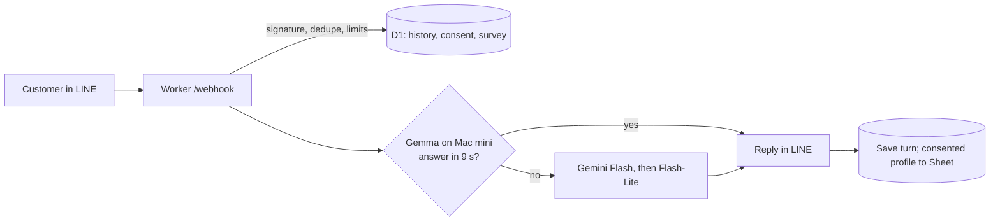
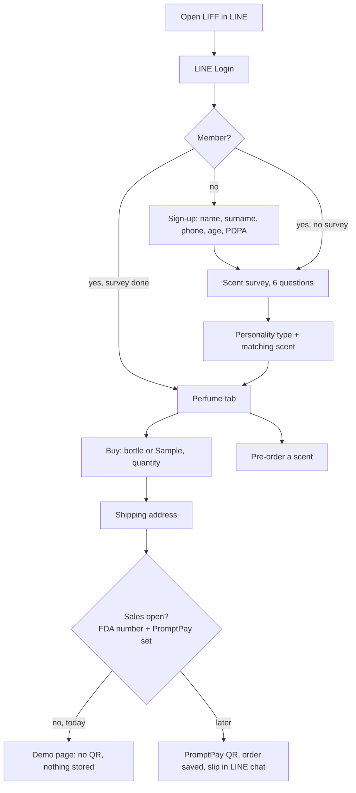

# BitterSweet Scent Concierge: what is built (branch v006-mini, 2026-10-31)

Live Worker version `ed849c9d` (deployed from the owner's Mac mini). One Cloudflare Worker serves the LINE chat bot,
the LINE web app (LIFF) and its API; one D1 database holds everything; Gemma on the Mac mini answers chat first and
Google Gemini is the backup.

## The parts

| Part | Where | What it does |
|---|---|---|
| LINE chat bot | `POST /webhook`, `src/handler.ts` | Verifies the LINE signature, loads history, consent and the survey, asks the AI model for a JSON answer, replies, saves the turn |
| AI models | `src/llm.ts`, `src/gemini.ts` | `hybrid`: Gemma 4 E4B on the Mac mini (max 9 s), then Gemini 3.6 Flash, then 3.1 Flash-Lite, all within 23 s |
| Mac mini link | `mac-mini/` | Ollama app + a gate that only lets through chat requests with two secret headers + a Cloudflare quick tunnel |
| Bot knowledge | `content/knowledge.md`, `content/system_prompt.md` | Product sheet V0.0.6: 5 scents, 450 THB bottle, 249 THB Sample with 30-day credit, not selling until the Thai FDA notification |
| Web app (LIFF) | `GET /app/`, `web/app.html`, `src/liff.ts` | LINE Login, sign-up, survey, perfume catalog, demo buy, pre-order, points |
| Sign-up | `POST /api/register`, `src/member.ts` | First name, last name, phone, age, PDPA consent (+ guardian under 20). +50 points |
| Scent survey | `POST /api/survey`, `src/survey.ts` | 6 questions, personality type and its scent, +30 points; the chat bot reads it |
| Buy (demo) | `POST /api/checkout`, `src/checkout.ts` | Bottle or Sample, quantity, address, PromptPay page. Stores nothing until `FDA_NOTIFICATION_NO` and `PROMPTPAY_ID` are set |
| Pre-order and points | `POST /api/waitlist`, `src/loyalty.ts` | Waitlist per scent (+30), points ledger |
| CRM | `src/crm.ts`, `apps_script/Code.gs` | Consented profile rows to a Google Sheet (not set up yet) |

## Flow 1: a LINE chat message

## Flow 2: the web app (LIFF)

## Flow 3: concept (data to marketing)

PDPA consent -> survey in LINE -> analyse by age group and personality type -> segments (clustering) -> marketing,
and a better chat answer for each customer. The survey answer codes match `scent-concierge/sample-data/SURVEY.md`.

## Data (D1 `bitter_sweet`)

| Table | Holds | Kept |
|---|---|---|
| `messages`, `processed_events`, `counters` | Chat history (customer text and bot reply), dedupe ids, rate limits | 7 days |
| `consents` | PDPA consent flag | Refreshed on use; deleted on request |
| `members` | Name, surname, phone, age, guardian flag | Until the customer asks to delete |
| `surveys` | Answer codes, age group, personality | Until the customer asks to delete |
| `points`, `waitlist` | Points (column `amount`), pre-orders | Until the customer asks to delete |
| `orders` | Empty while the shop is not selling | Kept for staff once selling |

Typing "ลบข้อมูล" in the chat deletes history, consent, points, waitlist, survey and member details.

## Safety rules that hold

- No real sale, payment or address before the FDA notification: the buy flow is a demo.
- Personal data only with consent; under 20 also needs a guardian; names and phones never go to logs or the Sheet.
- Every webhook is signature-checked; every web app call is checked with LINE (ID token).
- At most 3 model calls and 19 subrequests per chat message (Workers Free plan limit 50).

## Cost per month (estimate)

| Model | 3,000 messages | 60,000 messages |
|---|---|---|
| Gemma on the Mac (electricity) | ~64 THB | ~1,650 THB |
| Gemini 3.6 Flash | ~294 THB | ~7,400 THB |
| Claude Sonnet | ~749 THB | - |
| Claude Haiku | ~52 THB | - |

Figures from the earlier cost report (its PDF and simulator are not in this PR). Gemini prices double from
1 January 2027. That report's Docker test of Gemma passed 5/5 at about 11-12 s per answer; on the M4 Mac mini it
now answers in about 4 s.

## Running it

- Mac mini: open Ollama, then `sh mac-mini/start.sh`; keep the Mac awake. The tunnel address changes on restart,
  so redeploy: `npx wrangler deploy --var LLM_PROVIDER:hybrid --var LLM_BASE_URL:<new address>`.
- Checks before any deploy: `npm run typecheck && npm test && npm run lint` (186 tests).
- Details: `docs/MAC-MINI.md`, `docs/LIFF.md`, `docs/GEMINI.md`; the Mac mini install log and test results are in
  `docs/MAC-MINI-DEPLOY-REPORT.md`.

## Still open

- Google Sheet CRM not configured (paste `apps_script/Code.gs`, deploy, set the two secrets).
- Gemma still runs on for one question type ("Sample price") about 2 in 10 times; Gemini answers those.
- Selling needs the FDA number, the shop PromptPay id, and an update of the bot's "not selling" text.
